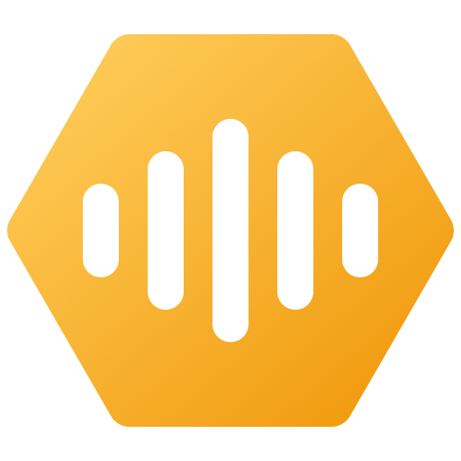

  

# Beecord

Open-source AI voice recorder: watch-form firmware + local-first companion apps.

- **Firmware** for the Waveshare ESP32-S3-Touch-AMOLED-2.06 board — records 16 kHz mono
  Ogg Opus to a microSD card, syncs files to a computer over BLE.
- **BuzzLink** — a small, documented BLE file-sync protocol (frame magic `BE EC`) used
  between device and apps.
- **Beecord Studio** — macOS companion app: browse & download recordings, playback,
  on-device transcription (whisper.cpp), optional cloud-AI summaries via
  OpenAI-compatible endpoints (Kimi, DeepSeek, ...).

> Status: early development (pre-M0). Protocol spec draft: [`docs/BUZZLINK.md`](docs/BUZZLINK.md).

## 简介（中文）

Beecord 是开源的 AI 录音手表项目：基于微雪 ESP32-S3-Touch-AMOLED-2.06 开发板的固件
+ 本地优先的 macOS 客户端（Beecord Studio）。设备本地录音存 TF 卡，经 BuzzLink
协议（BLE）同步到电脑；支持本地 whisper 转写，以及可选的云端 AI 摘要/纪要
（OpenAI 兼容端点，内容出域需显式开启）。项目处于早期开发阶段。

## Repository layout

| Path | Content |
|---|---|
| `firmware/` | ESP-IDF project (ESP32-S3, NimBLE, LVGL) |
| `apps/mac/` | Beecord Studio (SwiftUI, CoreBluetooth) |
| `sdk/python/`, `sdk/swift/` | BuzzLink client SDKs |
| `docs/` | BuzzLink protocol spec, guides |
| `tools/` | Development utilities |

## License

[Apache-2.0](LICENSE)

Commercial use is welcome — see [docs/COMMERCIAL.md](docs/COMMERCIAL.md) for what you must
handle yourself (certifications, privacy law, patents). This project is provided as-is;
nothing here is legal advice.
