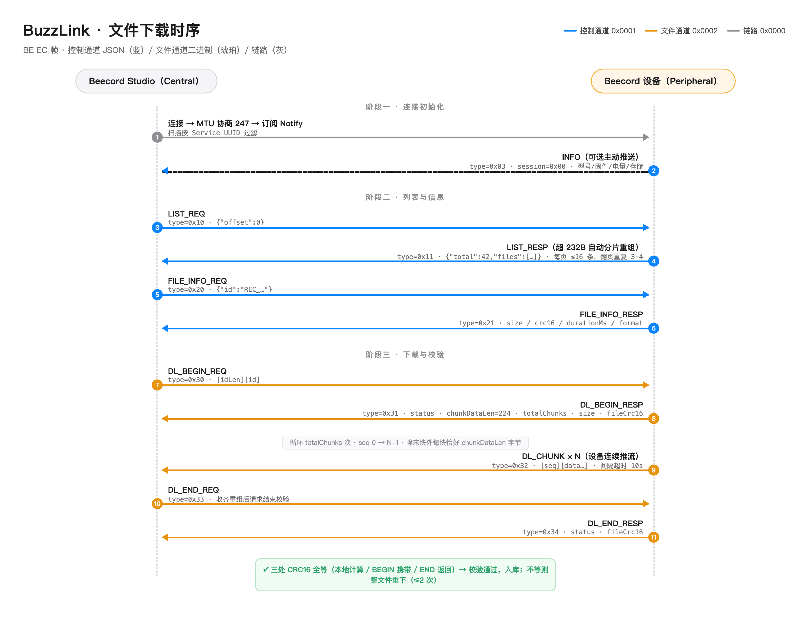

# BuzzLink 协议规范

> 版本：**v0.1 草案 → 实现基线**（2026-10-14）。本文是 Beecord 设备（Peripheral）与客户端
> （Central，如 Beecord Studio）之间 BLE 文件同步协议的**唯一实现依据**；
> 协议常量（魔数/UUID/命令字/块大小）以本文为准，实现中集中于
> `BuzzLinkConstants`（Swift）/ `buzz_proto.h`（C）单点定义。
> 修改流程：先改本文与测试向量（§11），再改实现。

## 1. 概述

设计目标：简单、可靠、跨平台易实现的**批量录音文件同步**（设备离机录音数小时后一次性同步），
同时为设备信息查询等控制操作提供 JSON 通道。

- 角色：客户端 = BLE Central；设备 = BLE Peripheral。
- 传输：BLE GATT 单一私有服务（write + notify 特征对），无配对绑定要求（P0）。
- 帧：`BE EC` 魔数小头帧；应用层 CRC16；支持消息分片。
- 通道：JSON 控制通道（查询类）+ 二进制文件通道（下载流水）。
- 文件：Ogg Opus（16 kHz 单声道 ~44 kbps），整块顺序推送，整文件 CRC-16 验收。

## 2. 传输层

### 2.1 GATT 定义

| 项 | UUID | 属性 |
|---|---|---|
| BuzzLink Service | `0E242009-7EF4-4AE0-B3B0-E3A59E58D47C` | Primary |
| Cmd Write（Central→Device） | `A2268D42-7024-430F-B059-9A156436973D` | Write Without Response |
| Event Notify（Device→Central） | `C22080F5-0E96-4823-8909-1DD2CE427D2D` | Notify |

- 命令统一走 Write Without Response（吞吐优先）；大数据一律走 Notify 下行。
- MTU：Central 请求 **247**（最低接受 185）；单帧 payload 上限按 §3.3。
- 连接参数建议：interval 15–30 ms、latency 0、supervision timeout ≥ 2 s；PHY 优先 2M。
- P0 不要求加密配对；后续若加入写/删类敏感操作，再评估链路加密。

### 2.2 广播

- 可连接非定向广播，AD 含 128-bit Service UUID（§2.1）+ Complete Local Name。
- 名称格式：`BCD-XXXX`（XXXX = 设备 ID 后 4 位大写字母数字，固件从 MAC 派生）。
- 客户端发现设备**以 Service UUID 过滤为准**，名称仅作展示。

## 3. 帧格式

### 3.1 布局（多字节一律小端）

| 偏移 | 字段 | 长度 | 说明 |
|---|---|---|---|
| 0 | magic | 2 | 固定 `0xBE 0xEC` |
| 2 | version | 1 | 协议版本，当前 `0x01` |
| 3 | type | 1 | 帧类型（§5.1） |
| 4 | session | 1 | 会话号（§3.4） |
| 5 | flags | 1 | bit0 = FRAG（分片，§3.3）；其余保留置 0 |
| 6 | channel | 2 | `0x0001` 控制（JSON）/ `0x0002` 文件（二进制） |
| 8 | length | 2 | payload 字节数（**不含** CRC） |
| 10 | payload | n | |
| 10+n | crc16 | 2 | CRC-16/CCITT-FALSE，覆盖范围 = version…payload（即偏移 2 到 10+n） |

帧头固定 10 字节，整帧 = 10 + length + 2。

### 3.2 CRC16

- 算法：**CRC-16/CCITT-FALSE**（多项式 0x1021，初值 0xFFFF，无输入/输出反射，异或出 0）。
- 自测向量：`crc16("123456789") = 0x29B1`；`crc16("Beecord") = 0x5D1E`。
- 用途有二：**帧 CRC**（每帧尾部，校验单帧完整性）；**文件 CRC**（§6.3，校验整个文件内容，
  与帧 CRC 独立计算）。两者算法相同、覆盖范围不同，不可混用。

### 3.3 单帧上限与分片

- 发送方**一帧对应一次 GATT 写/notify**；接收方必须按字节流重组（magic 同步 + length 取帧），
  容忍底层任意切分或合并。
- 单帧 payload 上限 = `MTU - 3 - 12`；MTU 247 时为 **232** 字节。
- 超过上限的消息（如文件列表页）使用分片：所有分片帧置 FRAG 位，payload 改为
  `fragIndex(2) fragCount(2) data…`（data ≤ 228）；同一消息的各分片 type/session/channel 相同，
  fragIndex 从 0 递增；接收方拼齐 fragCount 片后按完整消息分发。消息总上限 **64 KB**。
- 文件下载的数据块**不使用分片**（DL_CHUNK 天生小块，见 §6.2）。

### 3.4 会话与并发

- session 由**请求方**生成（递增回绕即可），响应帧原样回显；用于匹配迟到/乱序帧。
- 设备主动推送（INFO、DL_CHUNK）：INFO 用 session `0x00`；DL_CHUNK 沿用对应 DL_BEGIN 的 session。
- 每个 channel 同一时刻最多一个未完成命令；下载进行中控制通道仍可并行（如 PING/INFO_GET）。
- 超时：命令响应 **5 s**；下载中相邻 DL_CHUNK 间隔 **10 s**。超时即视为失败，按 §7 恢复。

## 4. 通道

| channel | 名称 | 载荷 | 承载 |
|---|---|---|---|
| `0x0001` | 控制 | JSON（UTF-8，camelCase 字段） | INFO/LIST/FILE_INFO/DELETE/ERROR |
| `0x0002` | 文件 | 二进制 | DL_BEGIN/DL_CHUNK/DL_END/DL_ABORT |
| `0x0000` | 链路 | 空 | PING/PONG |

## 5. 命令集

### 5.1 帧类型表

| type | 名称 | 方向 | channel | 说明 |
|---|---|---|---|---|
| `0x01` | PING | C→D | 0x0000 | 保活，无 payload |
| `0x02` | PONG | D→C | 0x0000 | 回显收到的 PING payload（通常为空） |
| `0x03` | INFO | D→C | 0x0001 | 设备信息 JSON；连接后可主动推送（session=0x00） |
| `0x04` | INFO_GET | C→D | 0x0001 | 请求设备信息，无 payload |
| `0x10` | LIST_REQ | C→D | 0x0001 | `{"offset":0}`，可选 `"limit"`（≤16） |
| `0x11` | LIST_RESP | D→C | 0x0001 | 文件列表页 JSON（§8.2） |
| `0x20` | FILE_INFO_REQ | C→D | 0x0001 | `{"id":"REC_…"}` |
| `0x21` | FILE_INFO_RESP | D→C | 0x0001 | 文件元数据 JSON（§8.3） |
| `0x30` | DL_BEGIN_REQ | C→D | 0x0002 | `[idLen u8][id…]` |
| `0x31` | DL_BEGIN_RESP | D→C | 0x0002 | `[status u8][chunkDataLen u16][totalChunks u32][size u32][fileCrc16 u16]`（13B） |
| `0x32` | DL_CHUNK | D→C | 0x0002 | `[seq u16][data…]`；设备连续推送 totalChunks 块 |
| `0x33` | DL_END_REQ | C→D | 0x0002 | `[idLen u8][id…]`；收齐后请求结束校验 |
| `0x34` | DL_END_RESP | D→C | 0x0002 | `[status u8][fileCrc16 u16]`（3B） |
| `0x35` | DL_ABORT | C→D | 0x0002 | `[idLen u8][id…]`；设备停止推流并应回 DL_END_RESP(status=2) |
| `0x40` | FILE_DELETE_REQ | C→D | 0x0001 | （P1 可选）`{"id":"REC_…"}` |
| `0x41` | FILE_DELETE_RESP | D→C | 0x0001 | （P1 可选）`{"status":"ok"}` |
| `0x7F` | ERROR | D→C | 0x0001 | `{"code":4004,"message":"file not found"}`（§9） |

status 字节：`0` ok / `1` not_found / `2` aborted / `3` busy / `4` bad_request / `5` storage_error / `6` internal。

### 5.2 文件 ID

UTF-8 不透明字符串，≤ 32 字节；固件命名 `REC_YYYYMMDD_HHMMSS`（设备本地时间）。
列表按起录时间**新→旧**排序；每页最多 16 条（超出用 offset 翻页）。

## 6. 会话流程

### 6.1 连接初始化

1. Central 按 Service UUID 扫描 → 连接 → 发现服务/特征 → 请求 MTU 247 → 订阅 Notify；
2. 设备可在订阅后 1 s 内主动推 INFO（session=0x00）；客户端也可随时 INFO_GET；
3. 空闲保活：下载/同步进行中流量即保活；空闲时客户端可每 15 s 发 PING，
   设备可在空闲 60 s 后主动断开（客户端应能自动重连）。

### 6.2 文件下载



1. `DL_BEGIN_REQ(id)` → `DL_BEGIN_RESP`：客户端记录 `chunkDataLen`（设备声明，≤ 230，
   **默认 224**；客户端必须按声明值处理，不得假设）、`totalChunks`、`size`、`fileCrc16`；
2. 设备顺序推送 `DL_CHUNK`（seq 从 0 递增；末块 data 长度 = `size - (totalChunks-1)*chunkDataLen`，
   可能为 0–chunkDataLen 之间任意值；**除末块外每块恰好 chunkDataLen 字节**）；
3. 客户端收齐 `totalChunks` 块 → 按 seq 重组为 size 字节 → 计算文件 CRC16；
4. `DL_END_REQ(id)` → `DL_END_RESP`：比对三处 CRC（本地计算 / BEGIN 携带 / END 返回），
   全等则验收通过；不等按 §7 重试。

### 6.3 完整性验收

- 文件 CRC16 覆盖**整个文件内容**（重组后的 size 字节），算法同 §3.2；
- 帧 CRC 仅保证传输单帧无损，不能替代文件 CRC（防重组逻辑错误、防设备端读取错误）。

## 7. 可靠性与恢复

| 异常 | 处理 |
|---|---|
| seq 跳号/重复 | 记录并继续接收；重复块忽略；最终以文件 CRC 裁决 |
| chunk 间隔超时（10 s） | 本次下载失败；可 `DL_ABORT` 清理设备侧状态后重试 |
| 文件 CRC 不等 | 整文件重新下载，最多 2 次；仍失败上报错误 |
| 命令响应超时（5 s） | 该命令失败，可重发（新 session） |
| 连接中断 | 全部未完成命令作废；重连后从 LIST 重新对账（幂等，按 id 去重） |

预留演进：块位图选择性重传（`0x36 DL_NACK`）、断点续传（BEGIN 携带起始 seq）——
P0 不实现，type 已预留。

## 8. JSON 数据模型

### 8.1 INFO（type 0x03）

```json
{
  "model": "beecord-watch",
  "fwVersion": "0.1.0",
  "protocol": 1,
  "deviceName": "BCD-1A2B",
  "battery": 87,
  "charging": false,
  "storageTotal": 31000000,
  "storageFree": 12345678
}
```

`storageTotal/Free` 单位字节；`protocol` = 协议版本号（对应 frame version）。

### 8.2 LIST_RESP（type 0x11）

```json
{
  "status": "ok",
  "total": 42,
  "offset": 0,
  "files": [
    { "id": "REC_20261014_091533", "durationMs": 58213, "size": 320012 }
  ]
}
```

错误时：`{"status":"error","code":4000,"message":"bad offset"}`。

### 8.3 FILE_INFO_RESP（type 0x21）

```json
{ "status": "ok", "id": "REC_20261014_091533", "size": 1011372, "crc16": 28474,
  "durationMs": 58213, "format": "ogg-opus", "sampleRate": 16000, "channels": 1 }
```

`crc16` 为十进制整数（0–65535）。

## 9. 错误码

| code | 含义 | code | 含义 |
|---|---|---|---|
| 4000 | bad_request（帧/参数非法） | 4130 | 消息超上限 |
| 4003 | forbidden | 4500 | 存储错误 |
| 4004 | not_found | 4999 | internal |
| 4009 | busy（如下载进行中又收 BEGIN） | | |

无法归入命令响应的异步错误统一走 `ERROR` 帧（JSON，带原 session 若能确定）。

## 10. 版本与兼容

- version 字节单调递增；接收方遇未知 version/type/flags 位：**忽略该帧**（不报错断连）；
- 新增命令只增 type，不改既有语义；JSON 只增字段，解析方忽略未知字段；
- 不兼容变更只能升 version，且设备须同时保留 v1 行为至少一个大版本。

## 11. 测试向量（帧级，含 CRC）

以下 hex 可直接用于编解码单测（接收方应解析出对应字段并验 CRC 通过）：

```
# V1 PING（type=0x01, sess=0x2A, chan=0x0000, 空载荷）
be ec 01 01 2a 00 00 00 00 00 86 7d

# V2 LIST_REQ {"offset":0}
be ec 01 10 2b 00 01 00 0c 00 7b 22 6f 66 66 73 65 74 22 3a 30 7d df cd

# V3 DL_BEGIN_REQ id="REC_20261014_091533"
be ec 01 30 31 00 02 00 14 00 13 52 45 43 5f 32 30 32 36 31 30 31 34 5f 30 39 31 35 33 33 d5 0c

# V4 DL_BEGIN_RESP（ok, chunkDataLen=224, totalChunks=4518, size=1011372, fileCrc16=0x6F3A）
be ec 01 31 31 00 02 00 0d 00 00 e0 00 a6 11 00 00 ac 6e 0f 00 3a 6f 02 47
```

分片示例（500 字节 JSON 消息分 3 片）：片 0/1 各 228 字节数据，片 2 为 44 字节；
三片 FRAG=1、type/session/channel 相同，fragIndex/fragCount 分别为 `(0,3) (1,3) (2,3)`。

会话级 JSON 向量（完整列表→下载→校验会话）随实现维护，路径见
[`TESTING.md`](TESTING.md) §3。

## 12. 实现指引

| 端 | 要点 |
|---|---|
| 固件（C） | 协议层硬件无关（见 [`CODING_STANDARDS.md`](CODING_STANDARDS.md) §3）；常量集中在 `buzz_proto.h`；推流节奏与连接参数联调 |
| Mac SDK（Swift） | 常量集中在 `BuzzLinkConstants`；notify 按字节流重组；chunkDataLen 以 BEGIN 声明为准 |
| BuzzLinkSim | 严格按本规范应答；故障注入不改变合法路径行为（见 [`TESTING.md`](TESTING.md) §5） |
