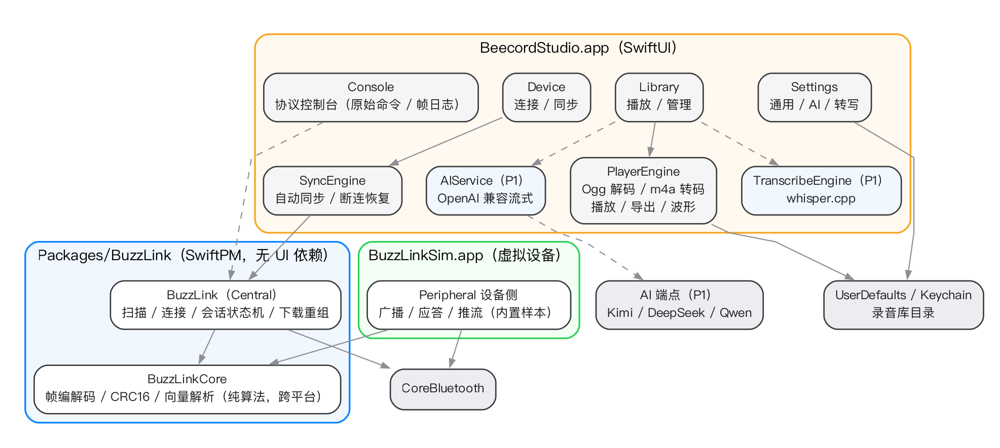

# Beecord Studio 技术设计（macOS）

> 状态：**v1.4**（2026-10-17）：T6 已交付——`BuzzLinkAudio` 新 target（Ogg demuxer 在
> Core、转码链/PlayerEngine/波形/导出在 Audio）、`LibraryCatalog` 对账 + manifest 缓存、
> 库页全量 UI（双徽标/重命名/自绘删除确认/详情播放器/Tab 占位）、存量补转幂等（实测闭环）、
> 库流 UITest 4 用例（合计 13）。包测试 **199 用例**（2 个活体冒烟 skip）、UITest 13 用例全绿。
> §5.1/§5.3 补 T6 落地注记（已知偏差：解码走 AVAudioConverter 逐包喂入、产物 48 kHz AAC、
> 临时产物 `tmp-<名>.m4a`、自绘确认对话框、波形 3pt 条 + 2pt 间隙自适应聚合）。
> 下一步 T7（协议控制台）。
> v1.3（2026-10-16）：UI 对齐原型定稿——设备页空态布局、侧栏品牌头 + 连接状态脚标 +
> 脚标设置入口（交互与令牌见 ux-design / DESIGN_SYSTEM §2.1，布局自检流程见 TESTING §4.5）；
> 本文口径修正：包测试 164 用例（2 个活体冒烟 skip）、BLE 跨机实测 ≈39.8 KB/s（T5 闭环）、
> §5.3 对账/manifest 缓存归属 T6。下一步 T6/T7。
> v1.2（2026-10-16）：T5 已落地——BuzzLinkSync 包 target（LibraryStore/SyncEngine）、
> 设备页全量 UI + 设置（传输方式/安全书签）+ 设备流 UITest（UITestSimServer 进程内设备源，9 用例全绿）。
> v1.1（2026-10-15）：T0.5/T1/T2/T3/T4 已落地。
> v1.0（2026-10-14）评审通过：总体形态与 PlayerEngine 决策按本方案执行；
> AI 预设 Kimi 默认模型改为 `kimi-k3`，见 §5.5。
> 上游依据：[`ux-design.md`](ux-design.md)（交互定稿）、
> [`DESIGN_SYSTEM.md`](DESIGN_SYSTEM.md)（令牌 + AX 规则 R1-R8）、[`BUZZLINK.md`](BUZZLINK.md)（协议规范）、
> [`BRAND.md`](BRAND.md)（品牌资产）。实施约束：[`CODING_STANDARDS.md`](CODING_STANDARDS.md)、
> [`TESTING.md`](TESTING.md)。
> 已决工程参数：部署目标 **macOS 15**；原生 `.xcodeproj` 入库；仓内签名为 Manual + ad-hoc
> （CI 用 `CODE_SIGNING_ALLOWED=NO`；本地真机调试用命令行覆盖个人证书，签名信息不入库）；
> Bundle ID `com.beeuc.beecord.studio`；Swift 6.3 / SwiftUI。

## 1. 目标与范围

| 阶段 | 内容 |
|---|---|
| **P0** | 扫描/连接/设备信息、文件列表/勾选下载/自动同步、CRC 校验、录音库管理、播放器（波形/倍速）、协议控制台、AX 可测（UITests 主流程） |
| **P1** | whisper.cpp 本地转写、AI 纪要（Kimi/DeepSeek/Qwen/自定义 OpenAI 兼容）、导出 m4a/wav、英文 i18n |
| 非目标 | iOS/iPadOS 版、iCloud 同步、实时转写、多设备并发连接、公证分发（notarization） |

关键事实：音频链 spike（原 P0 风险 S1）**已提前完成并验证**，结论见 §5.1——最大技术不确定性已消除。

## 2. 工程形态

```
apps/mac/
├── BeecordStudio.xcodeproj          # 原生工程，入库
├── BeecordStudio/                   # App target（SwiftUI）
│   ├── App/                         # 入口、NavigationSplitView、Settings 场景、
│   │                                #   LaunchOptions/LaunchTrace、LibraryRootResolver
│   ├── Common/                      # DesignTokens / Toast / EmptyState / KeychainStore / 安全书签
│   ├── Features/{Device,Library,Console,Settings}/
│   │                                #   Library（T6）：LibraryView/ViewModel、PlayerBar、
│   │                                #   Waveform、DetailActions/DetailTabs、RenameField
│   └── Resources/Assets.xcassets    # 图标取自 docs/brand
├── BuzzLinkSim/                     # 虚拟设备 app target（macOS + iOS/iPadOS 双平台；BLE 外设
│                                    #   + loopback TCP 127.0.0.1:40404 同机通道，见 TESTING.md §4）
├── Packages/BuzzLink/               # 本地 SwiftPM
│   ├── Sources/BuzzLinkCore/        # 纯算法：帧/CRC/向量（无 CoreBluetooth 依赖）；
│   │                                #   OggDemuxer 自研页遍历（T6，抛具名错不 crash）
│   ├── Sources/BuzzLinkSimCore/     # 设备侧协议引擎 SimEngine + 故障注入（纯逻辑，无 IO 依赖）
│   ├── Sources/BuzzLink/            # Central 封装（T2 已交付：BuzzLinkClient actor
│   │                                #   + BLE/loopback 双 Transport）+ 合作式即时取消（T5 A 阶段）
│   ├── Sources/BuzzLinkSync/        # LibraryStore + SyncEngine（T5）+ LibraryCatalog 与
│   │                                #   read 侧扩展（T6：actor，纯 Foundation）
│   ├── Sources/BuzzLinkAudio/       # T6 新增：转码链（demux→解码→AAC 写盘）、PlayerEngine、
│   │                                #   WaveformExtractor/Binner、AudioExporter（AVFoundation 依赖，
│   │                                #   纯逻辑时钟注入可单测）
│   ├── Sources/BuzzLinkTestSupport/ # 测试支撑 target（T5 A 阶段：SimEngineTransport 等，不进 products）
│   └── Tests/                       # 五个 test target（Core/SimCore/Central/Sync/Audio，共 199 用例，
│                                    #   2 活体冒烟 skip）+ Fixtures（在 BuzzLinkCoreTests 内）
└── BeecordStudioUITests/            # AX 驱动：骨架 4 + 设备流/库流端到端 9（UITestSimServer
                                     #   进程内设备源；库流 4 用例 T6 新增，共 13）
```

- **零三方依赖（P0）**；P1 仅引入 whisper.cpp（官方 SwiftPM 源码集成）。
- 并发模型：BLE 回调 → `AsyncStream`；UI 层 `@Observable`；下载/转写任务结构化并发。
- Sandbox 开启：`com.apple.security.device.bluetooth`、`com.apple.security.network.client`、
  `files.user-selected.read-write`（导出/模型目录选择）。Sim 同样开 Sandbox。
- 分发：GitHub 源码 + 用户自行构建；README 写清构建步骤（ad-hoc 签名即可本地运行，
  无需开发者账号；CI 亦按无证书构建）。

## 3. 总体架构



依赖规则：**UI 不直接触碰 CoreBluetooth**，设备交互只经 `BuzzLink`（Central 层，
唯一含 CoreBluetooth/Network 依赖的 SDK target）；`BuzzLinkCore` 仅依赖 Foundation（可在 Linux 跑单测）；
`BuzzLinkSim` 复用 `BuzzLinkCore` 帧层实现设备侧，与 Studio 互为对端——开发、联调、UITests 都不依赖硬件。

## 4. BuzzLink SDK

### 4.1 BuzzLinkCore（纯算法）

- 帧编解码：`BE EC` 魔数帧（type/session/channel/length/payload/crc16），含 notify 流粘包重组；
- CRC-16/CCITT-FALSE（查表法）；
- **OggDemuxer**（T6）：纯 Swift Ogg 页遍历/Opus 包提取（`pages`/`extractOpusPackets`），
  结构异常（版本错/seq 断裂/页跨度异常/截断）抛具名错误不 crash——转码链的输入侧；
- 测试向量 JSON 的 Codable 模型——**与协议控制台导出格式同一份 schema**（ux-design §3.5），
  控制台导出的会话可直接作为 `Tests/Fixtures` 回放。

### 4.2 BuzzLink（Central）

**T2 已交付**（2026-10-15）。实际形态：

- `BuzzLinkClient`（actor）：`connect/disconnect`、`ping`、`getDeviceInfo`、
  `listFiles(offset:limit:)`（分页）、`fileInfo(id:)`、整文件 `download(fileID:progress:)`
  （内置 BEGIN/CHUNK/END 全流程与重试；默认命令超时 5s、块超时 10s、3 趟，均可注入）；
  状态流 `stateUpdates`：`idle → scanning → connecting → ready → downloading → verifying → ready`，
  断连收敛到 `disconnected`（自动重连策略在 SyncEngine 层决定）；
- `BuzzLinkTransport` 抽象：`LoopbackTransport`（NWConnection → 127.0.0.1:40404，同机主通道）
  + `BLETransport`（CBCentralManager 薄壳：扫描 → 连接 → 服务/特征发现 → MTU → ready，
  write-without-response + 背压；**跨机实测已闭环**：2026-10-16 Mac Central ↔ iPhone Sim
  ≈39.8 KB/s，实测中修复跨 actor 断言崩溃，见 TESTING.md §4）；
- **协议常量集中 `BuzzLinkConstants` 一处**，以 [`BUZZLINK.md`](BUZZLINK.md) 规范为准。

扩展点（未做，按需再补）：beginDownload/chunk 流/endVerify 细粒度 API（T7 控制台逐帧展示用）；
删除等写命令 P1 评估。

**T5 A 阶段已补合作式即时取消**（2026-10-16）：`downloadWithRetries`/chunk 循环头与
`runCommand` 返回后插 `Task.checkCancellation()`——取消即时中断在飞下载并走
`DL_ABORT` 清理（不再依赖 ≤10s 超时兜底）；SyncEngine 侧 `.cancelling` 态有界收敛
（默认 3s，超时兜底断开重连）。取消语义详见 BuzzLinkClient/SyncEngine 头注释。

### 4.3 可靠性策略（P0）

设备推流 + 块序号 + 整文件 CRC16 验收，失败整文件重下（T2 实现默认 3 趟，
含块/命令超时后的 DL_ABORT 重试）；块位图选择性重传留作协议演进点（P1+ 评估）。

### 4.4 测试

现状 **199 用例、2 skip、0 失败**（T6 后）：Core 59（帧/CRC/向量 + OggDemuxer 畸形页矩阵）+
SimCore 33（引擎 + 故障注入矩阵）+
Central 55（命令/下载/状态机、乱序/截断/逐字节重组、进程内 SimEngine 集成——真实 Ogg 样本
全量下载验收、合作式即时取消）+ Sync 35（自动同步 diff/恢复/进度聚合/取消/重连/保活 +
FileLibraryStore 读写单测、LibraryCatalog 扫描/增量/事件）+
Audio 17（demuxer/转码 round-trip/导出/播放器状态机/波形提取与聚合——时钟注入不进音频设备）。
2 个 skip 均为活体冒烟（缺环境自动跳过，不进 CI 统计）：
`BLELiveSmokeTests` 需 `BLE_LIVE_SMOKE=1` + 对端设备前台广播，`LoopbackLiveSmokeTests`
需 Sim 正在运行。全部 XCTest、不依赖蓝牙硬件；
CI 门禁 `mac-test`（GitHub Actions，macos-26 + Xcode 26.6）执行本条与 xcodebuild 两条命令。

## 5. Studio app 服务层

### 5.1 PlayerEngine（关键决策）

**Spike 结论（2026-10-14 已实测，本机 macOS 26.5 SDK）**：

| 验证项 | 结果 |
|---|---|
| Ogg 页解封装（纯 Swift） | 可行（约 40 行） |
| CoreAudio **Opus 解码器**（16k/48kHz） | 存在；解码输出与 libopus 参考对齐 **93.4 dB SNR**，幅值一致 |
| CoreAudio Opus **编码器** | 不存在（不需要：设备端已编码，导出用 AAC/LPCM） |
| ffmpeg CAF muxer 写 opus | 不支持 |
| 手写 CAF-opus（AudioFileWritePackets） | 失败：第二包报 `'pty?'`（系统行为不稳定，放弃） |

**决策**：
1. **导入时一次转码** `ogg → m4a（AAC 48kbps）` 存库；播放、波形、导出、分享全部走 m4a
   （AVAudioFile / AVAssetReader，系统全场景兼容）；
2. 原 `.ogg` 保留在库目录，供"导出原始文件"；
3. 转码链：自研 Ogg demuxer → AudioConverter 流式解码 → AVAssetWriter（AAC）；
4. 播放：AVAudioEngine + AVAudioPlayerNode + AVAudioUnitTimePitch（1/1.5/2 倍速）；
   波形：AVAssetReader 分块取 min/max（长录音不整段驻留内存）；
5. 导出：`m4a`（直拷）、`wav`（解码 PCM 写入）、`ogg`（原件）。

弃用方案留档：CAF-opus 直读（系统支持不完整）；捆绑 ffmpeg（体积与签名复杂度高）。

**T6 落地注记**（2026-10-17，Phase A 实施偏差，均已实测）：

1. **解码载体**：demux 后用 **AVAudioConverter 逐包喂入**解码，非裸 AudioConverter——
   实测 AudioConverter 对 Opus 源静默空操作（noErr/0 输出、不调输入回调），哨兵 EOF
   还会被无限重试成 99% CPU；与 spike 结论同向的落法。
2. **产物规格**：统一 **48 kHz AAC**（系统 Opus 解码器原生输出 48k）；`meta.sampleRate`
   仍记源值 16k，时长误差 <50ms（round-trip 单测锁定）。
3. **临时产物名**：`tmp-<名>.m4a`（AVAssetWriter 校验扩展名，`.m4a.tmp` 被拒）→ 完成后
   同卷 move 覆盖正式名；崩溃残留 tmp-* 由 catalog 扫描时跳过、转码重跑覆盖。
4. **波形**：`WaveformExtractor` 分块取 min/max（AVAssetReader，长录音不整段驻留），
   600 列峰值缓存各目录 `waveform.json`（meta/文件替换时失效重建）；渲染前经
   `WaveformBinner` 把 600 列自适应聚合为**固定 3pt 条 + 2pt 间隙**，匹配原型密度
   （窗口宽度变化时条数自适应、条宽恒定）。

### 5.2 SyncEngine

**T5 已交付**（2026-10-16，`Packages/BuzzLink` 新 target `BuzzLinkSync`，纯 Foundation，
不依赖 SwiftUI/Observation；状态以 `AsyncStream<SyncSnapshot>` + `AsyncStream<SyncEvent>`
暴露，另提供 `snapshot` 只读当前值）。同步流程：

- 自动同步**默认开启**（ux 已决）：连接 ready → `getDeviceInfo()`（存储告警判定）→
  分页拉全设备列表 → 与库 diff → 队列化下载 → CRC 校验 → **入库（`audio.ogg` + `meta.json`）
  → 清理 `.partial`**；ogg→m4a 转码随 T6 已交付（入库即转 + 存量补转，见 §5.3）；
- 中断恢复：`.partial` 存在即未完成（启动 `purgeStalePartials()` 清理，P0 无断点续传，
  整文件重下）；按设备文件 id 幂等（`meta.source.fileID`），重复同步不产生副本；
- 状态机：`idle / connecting / ready / listing / syncing / cancelling / reconnecting / failed`；
  自动重连仅"曾 ready 的会话"掉线触发（退避 `[1,2,4,8,10,10,10]`s，耗尽回 idle + 事件），
  首连失败不自动重试；取消为合作式（client 即时取消 + DL_ABORT），有界收敛 3s；
  epoch 代数丢弃迟到结果；空闲保活 15s PING（仅 `.ready` 态）；
- 进度模型：`SyncProgress { completedFiles, totalFiles, currentFileID, fileFraction,
  overallFraction, bytesPerSecond, etaSeconds }`——字节加权整体进度（= UI `device.downloadProgress`
  的 AXValue），5s 滑动窗口速率，节流 100ms 发快照；
- LibraryStore：`<root>/Library/<recording-id>/{audio.ogg, meta.json}`，同卷原子 move +
  meta 原子写；`recording-id` = 设备文件 id 安全化（非法字符→`_`，截断 48，冲突加 `-2` 后缀）；
  自定义库根经 security-scoped bookmark 持久化（stale 回退默认容器 + toast）；
- 设备页 VM：`DeviceViewModel`（@MainActor @Observable）装配 transport 工厂
  （loopback/BLE，按设置）+ client + engine，消费双流驱动 UI；蓝牙权限面罩仅 BLE 模式。

### 5.3 录音库模型

**文件系统即数据库**（本地优先，Finder 可直接浏览）：

```
Application Support/Beecord/
├── Library/<recording-id>/
│   ├── audio.ogg            # 原始文件
│   ├── audio.m4a            # 播放用转码产物（T6；meta.audio.m4a 回填 "audio.m4a"）
│   ├── meta.json            # 标题/时长/大小/CRC/来源设备/转写·纪要状态/audio 产物字段
│   ├── waveform.json        # T6，波形 600 列 min/max 峰值缓存（随 m4a 重建）
│   ├── transcript.json      # P1，分段+时间戳
│   └── summary.md           # P1
├── Library/.catalog.json    # T6，目录 manifest（各目录 meta mtime，增量刷新用）
├── Library/.partial/        # 下载中
└── models/whisper/          # P1，ggml 模型
```

`recording-id` 安全化规则与 §5.2 LibraryStore 一致（设备文件 id，非法字符→`_`、截断 48、
冲突加 `-2`）。

**T6 落地**（2026-10-17）：`LibraryCatalog`（actor）已随库页交付——启动全量扫描对账 +
`.catalog.json` manifest（记录各目录 meta.json 修改时间）增量刷新 + `changes`
AsyncStream 边沿事件（added/removed/updated）驱动 UI 局部更新；坏 meta 跳过 + `os.Logger`
记录（同 FileLibraryStore 策略）。refresh 时机：app 启动、`syncCompleted`、页面 onAppear、
删除/重命名/转码回填后本地即时更新（`applyLocalRemoval`/`applyLocalUpdate`，不再重扫磁盘）。
**存量补转**：扫描发现 `meta.audio.m4a` 为 nil 的录音自动派发转码任务（串行队列），
产物就绪后原子 move + meta 原子回写；m4a 存在且非空即跳过（二次启动不重复转，实测闭环）；
失败行内红标「转码失败」+【重试】（点击即触发单任务）。**删除确认**为自绘 NSAlert 语义
对话框（SwiftUI `.alert` 挂不了 AX id；红字"删除"/取消默认聚焦 prominence 完整复刻，
AX `common.confirmDialog`），确认后整目录移除（含波形缓存）+ catalog 即时移除 + toast。

### 5.4 ConsoleStore（协议控制台）

环形缓冲（最近 5000 帧）；方向/type 过滤；行展开 hex；**导出 JSON 测试向量**
（schema 与 BuzzLinkCore 共用，见 §4.1）。

### 5.5 AIService（P1）

OpenAI 兼容 `POST /chat/completions`（SSE 流式，`URLSession.bytes`）；预设表：

| 预设 | baseURL | 默认模型 |
|---|---|---|
| Kimi | `https://api.moonshot.cn/v1` | `kimi-k3` |
| DeepSeek | `https://api.deepseek.com/v1` | `deepseek-chat` |
| Qwen | `https://dashscope.aliyuncs.com/compatible-mode/v1` | `qwen-plus` |
| 自定义 | 用户填写 | 用户填写 |

API key 存 Keychain（`kSecAttrAccessibleAfterFirstUnlock` + `ThisDeviceOnly`）；设置页"测试连接"；
首次开启 AI 功能时按 ux §1 弹出数据出域提示。模型名以设置页可编辑文本为准，上表为出厂默认
（2026-10-14 按各平台公开 API 模型列表核对：Kimi 平台当前无 k2.8 系模型 ID，旗舰通用模型为
`kimi-k3`；平台后续上新时用户可直接改填）。

### 5.6 TranscribeEngine（P1）

whisper.cpp（SwiftPM 集成，Metal 加速）；模型 `ggml-base`/`ggml-small` 在设置页显式下载
（SHA256 校验、断点续传）；产物 `transcript.json`（segments: start/end/text）；进度回调供 UI。

## 6. AX 与可测试性（落地 DESIGN_SYSTEM §4）

- 每个视图提交前自检：可交互控件都有 `accessibilityIdentifier`？动态行用稳定业务 id？
  图标按钮有中文 label？进度/开关暴露 AXValue？（对应 R1-R4、R6）
- 波形等自定义绘制包 `accessibilityElement`（R5）；快捷键表按 R7；Toast 走 `common.toast`（R8）；
- **UITests target**：骨架 4 用例 + 设备流端到端 9 用例已绿（UITestSimServer 进程内设备源，
  库流 4 用例 T6 新增：同步入列选择/播放走带/删除确认/空态联动；共 13 用例，CI 基线）；
  P0 全主流程（启动→发现 Sim→连接→列表→下载→校验→库内播放）已覆盖，T8 仅余 Accessibility
  Audit 收口；`xcodebuild test` 可跑，作为回归基线；
- **BuzzLinkSim 支持故障注入**（丢块/限速/中途断连），异常路径同样可脚本化验证；
- Accessibility Inspector Audit 无 error 级问题纳入 P0 验收。

## 7. 任务拆解（P0）

| # | 任务 | 状态/预估 | 依赖 |
|---|---|---|---|
| T0 | 音频链 spike | 已完成（2026-10-14） | — |
| T0.5 | BUZZLINK.md 补全（帧字段/命令集/常量） | 已完成 | — |
| T1 | BuzzLinkCore + XCTest | 已完成 | T0.5 |
| T2 | BuzzLink Central（BuzzLinkClient + BLE/loopback Transport，含进程内 SimEngine 集成） | 已完成（2026-10-15） | T1 |
| T3 | BuzzLinkSim（SimEngine 纯逻辑 + 故障注入 + 内置合成样本；macOS/iOS 双平台 BLE 外设 + loopback TCP） | 已完成（2026-10-15） | T1 |
| T4 | App 骨架（侧栏/设置窗口/AX id 全套/深色） | 已完成（2026-10-15） | — |
| T5 | 设备页 + SyncEngine | 已完成（2026-10-16） | T2、T4 |
| T6 | 录音库 + 播放器 | 已完成（2026-10-17，实测 4.25d） | T4 |
| T7 | 协议控制台 + 向量导出 | 1d | T2、T4 |
| T8 | UITests 主流程 + Audit | 1d | T3、T5、T6 |

P1 随后：T9 转写、T10 AI 纪要、T11 导出扩展、T12 i18n。

## 8. 风险与对策

| 风险 | 对策 |
|---|---|
| BLE 吞吐有限（经验值 10-30 KB/s；T5 跨机实测已闭环（2026-10-16）：Mac Central ↔ iPhone Sim ≈ **39.8 KB/s**，1h 录音约 20MB → 同步 ≈9 min） | 进度诚实展示 + 自动同步后台化；固件侧后续调 MTU/连接间隔/2M PHY |
| whisper 模型体积（base ≈142MB） | 设置页显式下载 + 进度 + 校验；不内置 |
| ad-hoc 分发的用户信任门槛（Gatekeeper 未签名提示） | README 构建指引；后续若有付费开发者账号再公证 |
| Sandbox 下 CBPeripheralManager（Sim） | 已验证（T3）：macOS 沙盒外设广播可用；新发现：**同机 Central 无法发现本机 Peripheral**（实测），对策 = loopback TCP 同机通道 + Sim 双平台跨机（TESTING.md §4） |
| 超长录音内存占用 | 波形/导出分块流式，禁止整段 PCM 驻留 |

## 9. 开放问题

1. ~~BUZZLINK.md 规范补全排期~~（已解决：T0.5 完成，T1/T2/T3 均按其落地）；
2. ~~库目录自定义位置~~（已解决：T5 安全书签最小版 + T6 `LibraryCatalog` 跨启动对账/
   manifest 缓存已落地，见 §5.3）；
3. 英文界面排期（建议随 P1 一起，首版中文）；
4. **多设备卡片列表（名称/RSSI）**（T5 划出的 P0 边界）：`BLETransport` 现为"扫描到首个
   匹配即停扫连接"的一次性连接，无发现结果流；需增加发现流 + `connect(to:)`，
   跨机 BLE 实测后扩展（ux §3.1 P0 注）。
