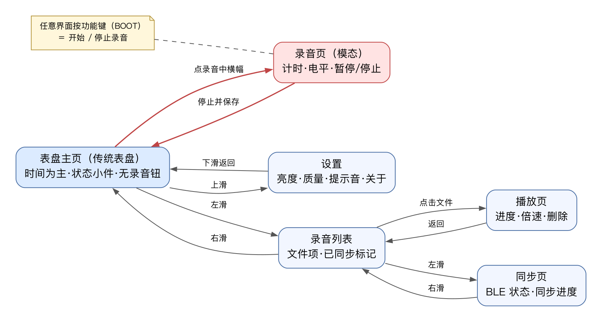
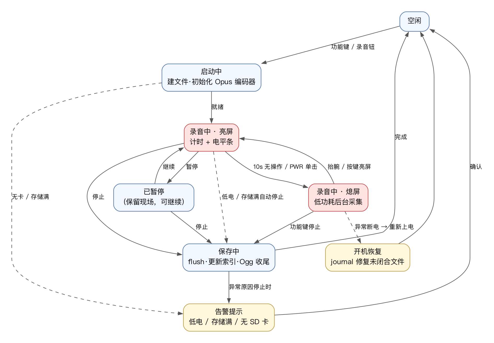

# Beecord 手表端交互设计（固件 UI）

> 状态：**已定稿**（2026-10-14 评审通过，结论见 §10）。配套可点击原型：[`prototype/watch.html`](prototype/watch.html)
> （浏览器直接打开）。评估通过后按本文档落 LVGL 实现。
> 硬件依据：微雪 ESP32-S3-Touch-AMOLED-2.06（2.06" AMOLED 410×502 触控、双侧键、
> 双麦+扬声器、400mAh、无震动马达），官方文档：https://docs.waveshare.net/ESP32-S3-Touch-AMOLED-2.06/

## 1. 设计原则

1. **录音优先**：任何界面（含熄屏）按一下功能键即开始录音；再按一下停止。核心路径不依赖触屏。
2. **熄屏优先**：亮屏续航仅 ~1 小时（熄屏 3~4 小时）→ 录音开始 10s 后自动熄屏，AMOLED 全黑省电，
   抬腕/按键才点亮确认状态。
3. **防误触**：熄屏时触控关闭；录音中亮屏也只做查看，停止操作走"长按停止区"或功能键。
4. **无震动马达**：全部反馈用提示音（扬声器）+ 屏幕视觉，提示音可关。
5. **触控为辅**：信息一屏读完、操作路径短；录音全流程（开始/暂停/标记/停止）不依赖触屏。

## 2. 硬件输入/输出映射

| 输入 | 空闲/浏览页 | 录音中·亮屏 | 录音中·熄屏 |
|---|---|---|---|
| 功能键(BOOT) 单击 | 开始录音 | 停止并保存 | 停止并保存 |
| 功能键 双击 | — | 暂停 / 继续 | 暂停 / 继续（保持熄屏） |
| 功能键 长按 1.5s | — | 打标记点（mark） | 打标记点 |
| PWR 单击 | 熄屏 ⇄ 亮屏 | 熄屏（录音继续） | 亮屏到录音页 |
| PWR 双击 | 回表盘主页 | — | — |
| PWR 长按 ~6s | 强制关机（**硬件行为，软件不可拦截**；录音靠 journal 开机恢复） | 同左 | 同左 |
| 抬腕（IMU） | 亮屏（可关）——**P1（M5 未做，M6 候选；M5 亮屏走按键）** | 亮屏到录音页 | 亮屏到录音页 |
| 触控 | 点击 / 四向滑动 | 查看与暂停区 | 关闭 |

M5.3 明确（原表"空闲/浏览页"未区分亮熄屏）：**空闲·熄屏**时功能键单击 = 直接开始录音
（不先唤醒——核心路径不依赖亮屏，录音页载入即点亮）；纯亮屏/熄屏切换一律走 PWR 单击。
即功能键 = 录音专用键，PWR = 电源/亮屏键。

注意：PWR 长按接近 6s 是 AXP2101 硬件断电，软件只能在 ~4.5s 时亮屏警告"即将关机"，无法取消。

## 3. 信息架构与导航

表盘主页为**传统表盘**（时间为主 + 状态小件），**不提供录音按钮**——录音入口是功能键全局热键，
避免持握/佩戴误触；录音中主页显示进行中横幅，点击进入录音页。
三个主页面**水平滑动**切换（表盘主页 ⇄ 录音列表 ⇄ 同步），主页**上滑**进设置、设置**下滑**返回；
录音页是**模态页**（覆盖全屏，停止后回主页）。页面指示点（3 点）提示当前主页面位置。

## 4. 页面清单

| 页面 | 内容 | 要点 |
|---|---|---|
| **表盘主页**（传统表盘） | 大时间/日期 + 状态小件（存储/待同步/最近录音）、电量、BLE 状态 | 默认页；**无录音按钮**；录音中显示进行中横幅（点入录音页） |
| **录音页**（模态） | REC 红点（闪烁）、大计时、实时电平条、暂停/继续、长按停止 | 10s 无操作自动熄屏，录音不中断 |
| **录音列表** | 文件行：起录时间、时长、大小、已同步标记 | P0 仅浏览；空态引导"按功能键录一条" |
| **播放页**（**P1**） | 文件名、进度条（可拖）、±15s、倍速 1×/1.5×/2×、删除（二次确认） | P1：扬声器外放与手表端删除随此项；P0 文件管理走 Mac |
| **同步页** | BLE 广播状态、"已连接 Studio"（静态文案——BLE 外设无法获知中央名）、待同步条数、同步进度、上次对时时间 | 同步由 Mac 端发起，手表侧只展示 |
| **设置** | 亮度 / 熄屏时间 / 录音质量 / 提示音 / 抬腕亮屏 / 对时状态 / 关于 | 行点击切换或循环取值，不做深层菜单 |

## 5. 关键流程

### 5.1 一键录音（核心路径）

1. 任意状态按**功能键单击** → "滴"一声 → 进入录音页（计时从 0 开始）；
2. 10s 无操作自动熄屏（录音继续，全黑省电）；
3. 再按**功能键单击** → "滴滴"两声 → 保存 → 回表盘主页，主页"最近录音"更新。

### 5.2 录音中查看与暂停

- 抬腕或 PWR 单击亮屏 → 录音页（计时 + 电平）；
- 功能键**双击**（或点暂停区）→ 暂停（长"滴—"一声，计时停、红点变静态）；再次双击继续；
- 功能键**长按 1.5s** → 打标记点（短"滴"，计时条上出现刻度）——用于会后定位重点。

### 5.3 同步（Mac 发起）

- Mac（Beecord Studio）连接后：自动对时 → 按 Mac 端设置自动/手动拉取文件；
- 手表侧：主页 BLE 图标变实心；同步页显示"已连接 Studio · 同步中 2/5"；
- 已同步文件在列表中带 ✓ 标记（设备端以"下载推流完整结束"判定，M5 规划 D3）；删除已同步文件时提示"已同步到 Mac"（删除为 P1）。

### 5.4 删除

播放页【删除】→ 二次确认浮层（取消 / 删除）→ 提示音 + 回列表。

## 6. 录音状态机

要点：**每 5s 定时 flush + journal 落盘**，异常断电（含 PWR 长按 6s 强制关机）后开机自动修复未闭合文件，
最多丢失最后几秒。

## 7. 状态与异常

| 场景 | 表现 |
|---|---|
| 低电 <15% | 主页电量橙色；<10% 录音中自动保存停止 + 三短提示音 |
| 存储将满 >90% | 主页存储条变红；满则禁止开始录音（按功能键 → 错误音 + 红条提示） |
| 录音中存储写满 | 自动保存停止 + 告警页 |
| SD 卡未插/不识别 | 录音功能禁用：按功能键开始 → 拒绝 + 错误音 + toast"无存储卡"（**熄屏时先唤醒屏幕再弹**，M5.3 定案）；主页存储小件区显示无卡状态（M5.5 数据接真时落）；**注**：本板无 SD 热插拔检测脚（1-bit SDMMC），运行中拔卡表现为写错误 → 自动停止 + 告警浮层，重新插卡需重启或重挂载 |

**错误反馈通用语义（M5.3 定案）**：错误/重要通知（录音失败、无卡、存储满、断电恢复等）= 提示音 + toast，
**熄屏态先唤醒屏幕再弹 toast**（按键操作的即时反馈，人正看着表；弹完走正常 10s 自动熄屏）；普通提示（如"已保存"）
维持熄屏吞掉策略（此时屏幕天然已亮，不冲突）。
| 充电中 | 电量图标带闪电；充电温度高时建议暂停大任务（暂不做） |
| BLE 断开 | 主页图标变空心；同步中断文件保持"未完成"，下次重传 |
| 异常断电后开机 | "已恢复未保存录音"toast，修复文件入列表 |

## 8. 声音反馈表（无震动马达的替代）

| 事件 | 提示音 |
|---|---|
| 开始录音 | 滴（1 短） |
| 停止并保存 | 滴滴（2 短） |
| 暂停 / 继续 | 滴—（1 长）/ 滴（1 短） |
| 打标记点 | 嘀（极短） |
| 低电自动停止 / 错误 | 滴滴滴（3 短） |
| 连接 Mac 成功 | 滴-滴（上扬） |

设置里可整体关闭提示音（关闭后仅屏幕反馈）。

## 9. 原型说明与边界

- 原型为**单文件 HTML**（无依赖）：左侧 410×502 等比手表屏（传统表盘主页，支持鼠标拖拽模拟滑动、方向键），
  右侧为硬件键与环境/评审场景面板；可直接切换“录音列表空态”或恢复演示录音（也可用 `?state=empty` 直达），播放页标注 P1；
- 可试全链路：功能键一键录音 → 10s 自动熄屏 → 亮屏暂停/继续 → 停止保存 → 列表播放（进度/倍速/删除）
  → 同步页模拟 Mac 连接同步 → 设置各项；
- 数据全部 mock；视觉细节（字号/间距/图标）以 LVGL 实现时按 410×502 实机微调，重点评估**导航结构与按键映射**。

## 10. 评审结论（2026-10-14 已决）

1. 功能键双击 = **暂停/继续**（维持现设计）；标记点挂长按 1.5s。
2. **不加**"亮屏触屏锁定"开关：自动熄屏 + 熄屏禁触已够。
3. 主页采用**传统表盘**：时间为主 + 状态小件，无录音按钮，录音全靠功能键全局热键（录音中横幅可点入录音页）。
4. 手表本地播放（扬声器外放）与手表端删除降为 **P1**；P0 聚焦"录 + 同步"，文件管理走 Mac。
5. 录音质量维持两档（标准 ~44kbps / 省空间 ~24kbps），不加高音质档。

**2026-10-20 修订（M5 规划联动，`docs/beecord/M5_PLAN.md` D1~D8）**：

6. **无"三击配对"**：Beecord 无 BLE 配对概念——开机常驻广播 `BCD-XXXX`，Mac 点连接即用，无需触发动作；
   产品化广播窗口（三击开关可发现）留作 M6+ 候选。
7. 同步页"已连接的 Mac 名称"降级为**静态文案"已连接 Studio"**（BLE 外设无法获知中央设备名）。
8. 抬腕亮屏降为 **P1**（M5 亮屏走按键）；新卡格式化确认弹窗场景与告警/关机/熄屏层规格已补入
   DESIGN_SYSTEM v1.6 §3。
